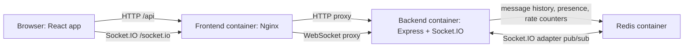

# Commonroom Project Guide

This guide explains Commonroom from the perspective of someone new to the codebase: what it is for, how its parts fit together, how a chat session works, and how to run and test it.

## 1. What the project does

Commonroom is a browser-based, guest-first, real-time chat application. A visitor chooses a display name and joins a room without creating an account. They can read recent room history, see who is currently present, switch rooms, and exchange messages live with other connected guests.

The application includes three default rooms (`general`, `random`, and `help`) and also supports custom room names. A room is shared by everyone who joins that room name; it is not private or access-controlled.

This is a lightweight collaboration/demo application, not a verified-identity or high-durability messaging platform:

- A display name is a label, not proof of identity.
- Messages are not end-to-end encrypted.
- Redis keeps recent room history, but is not a full durable database.
- A Redis outage prevents messages from being stored and therefore prevents their broadcast.

## 2. Technology at a glance

| Area | Technology | Responsibility |
| --- | --- | --- |
| Browser UI | React 19, Vite 8, Tailwind CSS 4 | Join screen, room navigation, message list/composer, presence and connection status |
| HTTP backend | Node.js ES modules, Express 5 | Guest session creation, room listing, history reads, health/readiness checks |
| Live communication | Socket.IO 4 | Authenticated guest connections, room membership, message and presence events |
| Storage and coordination | Redis 7, accessed with ioredis | Bounded message history, room registry, presence, rate counters, and Socket.IO adapter pub/sub |
| Production web server | Nginx | Serves the built frontend and proxies API and WebSocket traffic to the backend |
| Automated tests | Vitest, Supertest, Testing Library, jsdom | Backend API and service tests, Redis/socket integration tests, and frontend behavior tests |
| Local orchestration | Docker Compose | Builds and runs frontend, backend, and Redis as a connected application |

There is no SQL database or separate message broker. Redis is the backend's shared state store and the Socket.IO adapter's cross-instance transport.

## 3. High-level architecture



In a Docker deployment, only Nginx has a published host port. Nginx forwards `/api` and `/socket.io` to the backend over Docker's private frontend network. Redis is attached to a separate internal network shared only with the backend; it has no published host port.

### Main source areas

```text
backend/
  src/
    app.js                         Express middleware and API setup
    server.js                      Configuration, Redis startup, HTTP/Socket.IO lifecycle
    config/env.js                  Environment parsing and validation
    routes/api.js                  HTTP endpoint definitions
    sockets/chat.js                Socket authentication and chat event handlers
    repositories/                  Redis operations for history and presence
    services/                      Guest signing and Redis client setup
    validation/schemas.js          Zod input schemas and normalization
    middleware/errors.js           Consistent HTTP error responses
    scripts/cache-benchmark.js     Redis history read demonstration
  tests/                           Backend unit, API, and integration tests

frontend/
  src/
    App.jsx                        Guest/session entry point
    components/                    Join, chat layout, messages, users, status, and controls
    hooks/useChat.js               Socket lifecycle and chat state
    services/chatApi.js            HTTP API adapter
    services/chatSocket.js         Socket.IO client setup and acknowledgement helpers
    test/                           Vitest setup
  nginx.conf                       Production static hosting and reverse proxy
  Dockerfile                       Frontend build and Nginx runtime

docker-compose.yml                 Three-service deployment
redis/redis.conf                   Redis persistence and server settings
```

## 4. What happens when someone joins and chats

### 4.1 Join and guest identity

1. The browser loads the room list from `GET /api/rooms`.
2. On the join screen, the visitor chooses a display name and room. The UI performs basic checks, while the backend independently validates the values.
3. The browser sends `POST /api/guest-session` with `{ "displayName": "Ada" }`.
4. The backend trims and validates the name, generates a random UUID for the guest, and creates a 12-hour token. The token contains the guest ID, display name, and expiry, signed with HMAC-SHA256 using `GUEST_SESSION_SECRET`.
5. The browser maps the returned `token` to `sessionToken` and saves the guest session and selected room in that browser tab's `sessionStorage`. Closing the tab/session clears that browser-local state.
6. The frontend opens a Socket.IO connection and sends the signed token in the Socket.IO auth handshake. The server verifies the signature and expiry before accepting the connection.

The server does not trust a user ID or sender name from a message payload. It takes these values from the verified socket session.

### 4.2 Joining a room

The frontend emits `room:join` with `{ "roomId": "general" }` and waits for an acknowledgement. Room names are trimmed and converted to lowercase.

The backend then:

1. Applies the room-event rate limit and validates the event.
2. Registers the room in Redis so it appears in the known-room list.
3. Adds the socket to the Socket.IO room.
4. Registers the socket in Redis presence.
5. Reads the room's recent message history and current users.
6. Acknowledges with `{ success, data: { roomId, messages, users } }`, emits `room:joined` to the joining client, and broadcasts `presence:update`.

Joining a different room leaves the previous room first. The client uses acknowledgements rather than assuming that a room change worked.

### 4.3 Sending and receiving a message

1. The browser emits `message:send` with the active `roomId`, message `content`, and a UUID `clientMessageId`.
2. The backend confirms the sender has joined that room, validates the message, and enforces a per-socket message rate limit.
3. The backend creates the server message ID and timestamp. The sender identity is taken from the authenticated session.
4. The message repository runs one Redis Lua script to check for a retry, record the idempotency key, append the message, trim the room history to its configured maximum, and register the room.
5. Only after Redis confirms a successful write does the backend broadcast `message:new` to that Socket.IO room and acknowledge the sender.
6. The frontend merges the acknowledgement and broadcast without displaying the same message twice.

If the acknowledgement times out, the composer keeps the unconfirmed content and retries with the same `clientMessageId`. Redis recognizes that sender/client ID pair for 24 hours, returns the original message, and avoids a second history entry or broadcast.

### 4.4 Leaving and presence

Presence is tracked by guest and socket, so opening the same guest session in multiple tabs does not make the guest disappear when only one tab closes. The UI lists each guest once per room.

Socket presence expires after 90 seconds without a heartbeat. The backend refreshes presence every 30 seconds. Explicit room leave and socket disconnect remove the socket; a user is removed from the room only when their final socket leaves. Stale presence entries are also pruned when the room's users are read.

## 5. HTTP and Socket.IO interfaces

HTTP API responses use this envelope:

```json
{ "success": true, "data": {}, "error": null }
```

| Request | Purpose |
| --- | --- |
| `GET /api/health` | Liveness check; confirms the backend process responds, without checking Redis |
| `GET /api/ready` | Readiness check; pings Redis and returns HTTP 503 if Redis is unavailable |
| `POST /api/guest-session` | Validate a display name and issue a signed guest session |
| `GET /api/rooms` | Return default rooms and rooms previously registered in Redis |
| `GET /api/rooms/:roomId/messages?limit=50` | Return recent messages in chronological order; `limit` is 1–100 and defaults to 50 |

Socket.IO uses `auth: { sessionToken }` during connection. The principal client events are:

| Client event | Payload / result |
| --- | --- |
| `room:join` | `{ roomId }`; acknowledgement includes room history and users |
| `room:leave` | `{ roomId }`; acknowledgement confirms leave |
| `message:send` | `{ roomId, content, clientMessageId }`; acknowledgement includes the stored message and duplicate status |

Server events are `room:joined`, `room:left`, `message:new`, `presence:update`, and `system:error`. Message entries include `id`, `clientMessageId`, `roomId`, `senderId`, `senderName`, `content`, and an ISO-8601 `timestamp`.

## 6. Backend responsibilities and safeguards

- **`server.js`** validates configuration, connects Redis clients before listening, creates the repositories and servers, and closes Socket.IO and Redis clients on shutdown.
- **`app.js`** configures Helmet security headers, Pino HTTP logging, a 16 KiB JSON body limit, a general API rate limit (120 requests per minute), the API router, and shared error handlers.
- **`routes/api.js`** implements the HTTP API and a separate guest-session creation rate limit (20 requests per minute).
- **`sockets/chat.js`** authenticates each connection, enforces connection/message/room-event rate limits, and handles room and message events.
- **`validation/schemas.js`** uses Zod for input validation, trims names/content, normalizes room names, rejects control characters, checks UUID client IDs, and rejects unexpected fields in strict payloads.
- **`middleware/errors.js`** returns a consistent JSON error envelope and avoids returning internal error details for server failures.
- **`utils/logger.js`** uses Pino and redacts authorization, cookies, passwords, session tokens, and tokens from logs.

Socket rate limits are stored in Redis: at most 30 connection attempts per IP in a 10-second window, 12 messages per socket in a 10-second window, and 20 room events per socket in a 10-second window. These checks and the HTTP rate limits are protections for this application, not a substitute for an edge proxy, production abuse monitoring, or deployment-specific controls.

## 7. Redis: what is stored and why

The backend creates three authenticated ioredis connections:

- `cache` runs application commands, health pings, repository operations, and rate counters.
- `pub` and `sub` are passed to the Socket.IO Redis adapter, which distributes Socket.IO room events between backend instances.

The adapter is for cross-instance event delivery; it does **not** store chat history. History is stored separately by the message repository.

### Data model (conceptual)

| Data | Redis representation | Lifetime/behavior |
| --- | --- | --- |
| Room history | A Redis list for each encoded room name | Stores only the latest configured number of messages; default maximum is 100 |
| Message retry keys | A key per room, sender, and `clientMessageId` | Expires after 24 hours; makes client retries idempotent |
| Known rooms | Set at `chat:rooms` | Includes default rooms in API results; custom room names are recorded when joined or messaged |
| Active sockets/users | Socket keys, per-user socket sets, room user sorted sets, and user details hashes | 90-second socket TTL refreshed by heartbeat; room presence is unique per guest |
| Rate limits | Incrementing keys for connection, message, and room-event windows | Expire after the rate-limit window |

Room names are Base64URL-encoded in room history/presence keys to keep key construction stable and avoid using raw room text as a Redis key segment. Message append and presence changes use Lua scripts so related Redis operations happen atomically.

### Persistence and limits

`redis/redis.conf` enables AOF (`appendonly yes`, fsync every second) plus periodic RDB snapshots. The Compose file mounts `/data` on the named volume `realtime-chat-redis-data`, so `docker compose down` retains Redis state. `docker compose down -v` removes that volume and its messages.

Persistence improves recovery across ordinary container restarts, but Redis is still the application's temporary store rather than an archival database. It stores a bounded recent history, and the project does not provide database backups, message search, or guaranteed delivery through an outage.

Redis requires the `REDIS_PASSWORD` at startup. `redis.conf` also disables selected administrative/destructive commands (`FLUSHDB`, `FLUSHALL`, `CONFIG`, `SHUTDOWN`, and `DEBUG`). The Compose Redis service has no host port mapping and is only on the internal Redis network.

## 8. Docker Compose and the production-style container setup

`docker-compose.yml` defines exactly three services:

### `frontend`

- Builds the React app in a Node build stage.
- Copies the generated static assets into an Nginx runtime image.
- Publishes host port `${FRONTEND_PORT:-3000}` to container port 80.
- Waits for backend health before starting.
- Nginx serves the single-page app, exposes `/healthz` for its health check, proxies `/api` to `backend:4000`, and proxies `/socket.io/` with WebSocket upgrade headers.
- Includes browser security headers and a Content Security Policy.

### `backend`

- Uses a multi-stage Node 24 Alpine build and installs production dependencies with `npm ci --omit=dev`.
- Runs as the unprivileged `node` user.
- Exposes port 4000 to other containers, but Compose does not publish it on the host.
- Joins both Docker networks: it receives frontend traffic from Nginx and connects to Redis over the private Redis network.
- Has a readiness health check that calls `/api/ready`; it is considered unhealthy when Redis is unavailable.
- Uses `init: true` and `no-new-privileges:true`.

### `redis`

- Uses the pinned `redis:7.4.2-alpine` image.
- Starts with the checked-in Redis configuration and password authentication.
- Persists `/data` in the named Compose volume.
- Joins only the internal Redis network; no host port is published.
- Uses an authenticated `redis-cli ping` health check.

### Networks and startup

`frontend_net` is a bridge network for frontend and backend traffic. `redis_net` is an `internal: true` bridge for backend and Redis. This separates the Redis service from the frontend container and host-published application port. A Docker bridge does not replace host firewalling or production network controls.

Compose starts Redis before the backend, and backend before frontend, using health conditions. The frontend is the only service that publishes a host port.

### Run with Docker

From the repository root in PowerShell:

```powershell
Copy-Item .env.example .env
```

Edit `.env`, replacing `REDIS_PASSWORD` and `GUEST_SESSION_SECRET` with separate, strong random values. The guest secret must be at least 32 characters. Do not commit `.env`.

```powershell
docker compose up --build -d
docker compose ps
```

Open `http://localhost:3000` in two browser sessions, choose different display names, and join the same room. Useful operations:

```powershell
docker compose logs -f backend frontend redis
docker compose down
```

`docker compose down` preserves the named Redis volume. To delete the volume and stored history as well:

```powershell
docker compose down -v
```

## 9. Local development and configuration

Use Node.js 22 or 24 (the package manifests support `>=22 <25`).

For the backend, configure its required Redis connection and a guest-session secret of at least 32 characters. Start an authenticated Redis server separately, then:

```powershell
Copy-Item .env.example backend\.env
notepad backend\.env
Push-Location backend
npm install
npm start
Pop-Location
```

For local development, set `REDIS_HOST=127.0.0.1` and the actual local Redis port in `backend\.env`; the template's `REDIS_HOST=redis` is for Docker Compose service discovery.

For frontend development, start the backend and Redis first, then:

```powershell
Push-Location frontend
npm install
npm run dev
Pop-Location
```

Vite serves the app at `http://localhost:5173` and proxies `/api` and `/socket.io` to `http://127.0.0.1:4000` by default. `VITE_BACKEND_PROXY` changes that proxy target. `VITE_SOCKET_URL` changes the Socket.IO origin if it must differ from the page origin. Vite variables are public browser configuration; never put Redis passwords or the guest-session signing secret in them.

### Important environment variables

| Variable | Purpose | Default / constraint |
| --- | --- | --- |
| `FRONTEND_PORT` | Host port for Nginx | `3000` |
| `PORT` | Backend listen port | `4000` |
| `NODE_ENV` | Backend runtime mode | `production` in Compose |
| `REDIS_HOST`, `REDIS_PORT` | Redis endpoint from backend | `redis:6379` in Compose; local backend defaults to `127.0.0.1:6379` |
| `REDIS_PASSWORD` | Redis authentication | Required |
| `GUEST_SESSION_SECRET` | HMAC signing key for guest tokens | Required, minimum 32 characters |
| `CORS_ORIGIN` | Allowed Socket.IO browser origin | `http://localhost:3000` in Compose |
| `MESSAGE_HISTORY_LIMIT` | Maximum retained messages per room | `100`, allowed range 1–100 |
| `MESSAGE_MAX_LENGTH` | Maximum accepted message length | `2000`, allowed range 1–10000 |
| `REDIS_TEST_HOST`, `REDIS_TEST_PORT`, `REDIS_TEST_PASSWORD` | Authenticated Redis endpoint for backend integration tests | `127.0.0.1:6389`, password `backend-test-password` |

The Compose configuration requires a `.env` file (or equivalent exported variables) with the Redis password and guest secret. The `.env.example` file is a template, not a set of production secrets.

## 10. Unit and integration testing

Each application has its own package manifest and test command. Run both test suites and build the frontend with:

```powershell
Push-Location backend
npm test
Pop-Location

Push-Location frontend
npm test
npm run build
Pop-Location
```

### Backend tests

Backend tests use Vitest. API tests use Supertest and fake repository/Redis dependencies where possible, so most can run without Redis.

- **`backend/tests/validation.test.js`**: display-name validation, normalized room names, message trimming/line endings, length limits, UUID IDs, and strict payload fields.
- **`backend/tests/guest-sessions.test.js`**: valid signed session creation/verification and rejection of modified, expired, or differently signed tokens.
- **`backend/tests/api.test.js`**: HTTP liveness/readiness, room and history responses, invalid inputs, guest-session creation, and safe JSON errors.
- **`backend/tests/redis.integration.test.js`**: real Redis repository behavior: room key isolation, idempotent history writes, chronological bounded retention, and multi-socket presence.
- **`backend/tests/sockets.integration.test.js`**: real Socket.IO and Redis behavior: room isolation, invalid payloads, history on join, retry deduplication, no broadcast on storage failure, and presence across multiple sockets.

The Redis repository and Socket.IO integration cases connect to the authenticated test Redis at `127.0.0.1:6389` by default. If unavailable, those integration cases are explicitly skipped and the suite reports that condition; a green run without Redis does not validate those integration paths. Set `REDIS_TEST_HOST`, `REDIS_TEST_PORT`, and `REDIS_TEST_PASSWORD` to use a different test Redis. Do not point tests at a Redis instance containing data you need: integration tests create test-specific keys.

One way to run a disposable local test Redis (if port 6389 is free) is:

```powershell
docker run --rm -d --name commonroom-test-redis -p 6389:6379 redis:7.4.2-alpine redis-server --requirepass backend-test-password
```

Stop it after the tests with `docker stop commonroom-test-redis`.

### Frontend tests

Frontend tests use Vitest in jsdom, React Testing Library, and user-event. They do not require a running backend or Redis.

- **`src/components/JoinScreen.test.jsx`**: guest-name validation, room-name normalization, and room choices.
- **`src/components/MessageComposer.test.jsx`**: Enter/Shift+Enter behavior and retrying an unconfirmed message with the same ID.
- **`src/services/chatApi.test.js`**: API response handling and mapping the guest token to the Socket.IO auth field.
- **`src/hooks/useChat.test.jsx`**: Socket.IO event contract, message acknowledgement/broadcast de-duplication, room switching, and room-filtered presence updates.

`npm run build` checks that Vite can compile the production frontend assets. The Docker frontend image performs this build during its build stage.

## 11. Cache benchmark

`backend/src/scripts/cache-benchmark.js` compares the repository's Redis history read (`LRANGE` plus JSON parsing) against a synthetic in-memory JSON clone. It seeds up to 100 deterministic messages in a temporary room, verifies both paths return identical arrays, warms the operations, reports total/average/median/p95 latency, and removes its temporary keys.

Run it from a running Compose deployment:

```powershell
docker compose exec backend node src/scripts/cache-benchmark.js
docker compose exec -e BENCHMARK_OPERATIONS=2000 backend node src/scripts/cache-benchmark.js
```

This is a demonstration of the Redis access path, not a Redis-versus-database benchmark. The Redis path includes a container network round-trip and parsing; the baseline is in-process. Results depend on the machine, load, and Docker overhead.

## 12. Troubleshooting

- **Compose says a required secret is missing:** create `.env` from `.env.example` and set a strong `REDIS_PASSWORD` and a `GUEST_SESSION_SECRET` of at least 32 characters.
- **Backend is unhealthy:** check `docker compose logs backend redis`. `/api/ready` intentionally fails while Redis is unavailable or cannot authenticate.
- **Frontend loads but API calls fail:** check Nginx/backend logs and ensure `/api` routes to backend port 4000.
- **The app loads but live events do not work:** check `/socket.io` proxying, WebSocket upgrade headers, and allowed `CORS_ORIGIN`.
- **Redis data disappeared after cleanup:** `docker compose down -v` removes the named Redis volume; ordinary `docker compose down` keeps it.
- **Integration tests skipped:** start an authenticated Redis test instance on the configured test host/port and rerun the backend tests.

## 13. Known boundaries and future considerations

- Guest display names and signed sessions provide continuity, not account ownership or verified identity.
- The UI and API do not implement room privacy, user roles, moderation, or end-to-end encryption.
- A bounded history means older messages are trimmed; there is no archive or search feature.
- Redis is required for backend startup and runtime operations. The app intentionally surfaces storage failures instead of broadcasting messages that were not stored.
- Redis AOF/snapshots and a Docker volume are useful local persistence, but not a backup, disaster-recovery, or multi-region strategy.
- Before public production use, consider TLS termination, managed secrets, external abuse controls, monitoring/alerting, backups, retention policy, and a durable database if long-term history is required.
