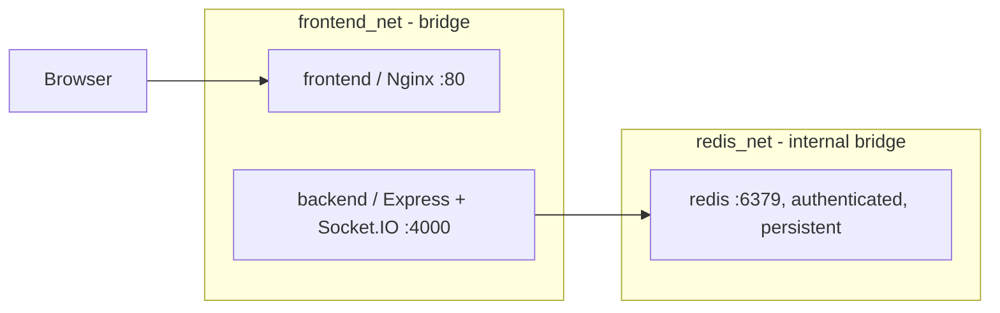

# Commonroom Real-Time Chat

A guest-based real-time chat app built with React, Express, Socket.IO, and Redis. The application is split into exactly three Compose services: frontend, backend, and Redis.

## Start with Docker Compose

Prerequisites: Docker Desktop with Compose v2 or later. Create a local environment file and generate two independent 32-byte secrets in PowerShell:

```powershell
Copy-Item .env.example .env
function New-Secret {
  $bytes = New-Object byte[] 32
  $rng = [Security.Cryptography.RandomNumberGenerator]::Create()
  try {
    $rng.GetBytes($bytes)
    -join ($bytes | ForEach-Object { $_.ToString('x2') })
  } finally {
    $rng.Dispose()
  }
}
New-Secret
New-Secret
notepad .env
```

Put one generated value in `.env` as `REDIS_PASSWORD` and the other as `GUEST_SESSION_SECRET`. The guest secret must be at least 32 characters. `.env` is ignored by Git and must not be committed. The frontend image receives no secrets.

```powershell
docker compose up --build -d
docker compose ps
```

Open `http://localhost:3000` in two browser sessions, use different display names, and join the same room. The frontend proxies API and Socket.IO traffic to the backend inside Docker.

Stop the containers with `docker compose down`. Redis data remains in the named `realtime-chat-redis-data` volume. To also remove stored messages and Redis data, run `docker compose down -v`.

## Services and network boundaries



`frontend_net` contains only frontend and backend. `redis_net` contains only backend and Redis and is marked `internal: true`. Only frontend publishes a host port. Redis has no `ports` mapping; the backend reaches it at `redis:6379`. A Docker bridge is private to its Docker host by default, not a replacement for host firewall rules or production network security.

Verify the service, port, and network boundaries in PowerShell:

```powershell
docker compose ps
docker compose port frontend 80
docker compose port redis 6379
docker inspect realtime-chat-redis-1 --format '{{json .NetworkSettings.Networks}}'
docker inspect realtime-chat-frontend-1 --format '{{json .NetworkSettings.Networks}}'
docker inspect realtime-chat-redis-1 --format '{{json .NetworkSettings.Ports}}'
```

The `docker compose ps` port column should show a mapping only for `frontend`. `docker compose port redis 6379` must not return a host endpoint (`:0` means no published mapping on some Compose versions), and inspect should show `{"6379/tcp":null}`. Container suffixes may vary if the Compose project name changes.

## Health, logs, and tests

```powershell
docker compose logs -f backend frontend redis
docker compose exec backend node -e "fetch('http://127.0.0.1:4000/api/ready').then(async r => console.log(r.status, await r.text()))"
docker compose exec redis sh -c 'REDISCLI_AUTH="$REDIS_PASSWORD" redis-cli ping'
# Expected to fail: the frontend container cannot resolve the Redis service.
docker exec realtime-chat-frontend-1 wget -q -T 2 -O /dev/null http://redis:6379
Push-Location backend; npm test; Pop-Location
Push-Location frontend; npm test; npm run build; Pop-Location
```

Backend and frontend setup details are in [backend/README.md](backend/README.md) and [frontend/README.md](frontend/README.md). Redis persistence uses AOF plus periodic snapshots. History remains bounded to the configured latest 100 messages per room; guest identities are not verified, chat is not end-to-end encrypted, and delivery is not guaranteed during Redis outages.

## API and Socket.IO contract

- `GET /api/health` reports process liveness; `GET /api/ready` checks Redis and returns 503 when Redis is unavailable.
- `POST /api/guest-session` accepts `{ "displayName": "Ada" }` and returns a server-generated guest ID, display name, signed `token`, and expiry.
- `GET /api/rooms` returns default and known rooms.
- `GET /api/rooms/:roomId/messages?limit=50` returns chronological history; the maximum is 100.
- Socket authentication uses `io(url, { auth: { sessionToken: token } })`.
- `room:join` / `room:leave` use `{ "roomId": "general" }`. The join acknowledgement returns `{ success, data: { roomId, messages, users } }`.
- `message:send` uses `{ "roomId": "general", "content": "Hello", "clientMessageId": "<UUID>" }` and an acknowledgement timeout. Failed writes return an error and are not broadcast.
- Server events are `room:joined`, `room:left`, `message:new`, `presence:update`, and `system:error`.

History entries contain `id`, `clientMessageId`, `roomId`, `senderId`, `senderName`, `content`, and ISO timestamp. Redis stores a bounded list per room and uses idempotency keys for retries. The Socket.IO Redis adapter distributes events between backend instances; it does not store history. Redis persistence is enabled, but Redis remains temporary application storage, not a durable database.

## Cache benchmark

Run the benchmark from inside the backend container so Redis stays unpublished:

```powershell
docker compose exec backend node src/scripts/cache-benchmark.js
docker compose exec -e BENCHMARK_OPERATIONS=2000 backend node src/scripts/cache-benchmark.js
```

The script seeds one room with up to 100 deterministic messages, warms both paths, confirms their returned arrays are identical, and measures repeated reads. The Redis path uses the actual repository (`LRANGE` plus JSON parsing). The explicitly synthetic baseline clones the same in-memory message array through JSON serialization/deserialization; it is not a database comparison and does not imply Redis is universally faster. Output reports operation count, message count, total elapsed time, average, median, and p95 latency. The benchmark cleans up its temporary room/history keys. Results vary with Docker overhead, machine load, hardware, and network latency; rerun on the machine whose performance you need to assess.

One verified run in this Docker Desktop environment (2026-10-24; backend container to Redis container on the same host; 1,000 measured operations over 100 messages) produced:

| Path | Total | Average | Median | p95 |
| --- | ---: | ---: | ---: | ---: |
| Redis history read | 265.44 ms | 0.265 ms | 0.2103 ms | 0.5135 ms |
| In-memory JSON baseline | 126.57 ms | 0.1262 ms | 0.1149 ms | 0.1627 ms |

The outputs matched. In this specific run, Redis was slower because this benchmark includes a container network round-trip and JSON parsing while the baseline is in-process. It is a reproducible cache-path demonstration, not a Redis-versus-database performance claim. Hardware details were not captured, so repeat the benchmark on the machine whose performance you need to assess.

## Troubleshooting

- If Compose reports a missing `REDIS_PASSWORD` or `GUEST_SESSION_SECRET`, create `.env` from `.env.example` and set both values before running Compose.
- If backend is unhealthy, inspect `docker compose logs backend redis`; readiness intentionally fails while Redis is unavailable.
- If the frontend loads but requests fail, inspect `docker compose logs frontend backend` and verify `/api` and `/socket.io` are routed through Nginx.
- To confirm Redis isolation, the frontend container should fail to resolve the `redis` service name, while the backend readiness endpoint reports `ready`.
- `docker compose down` stops services but retains Redis data. `docker compose down -v` removes the Redis volume and its messages.